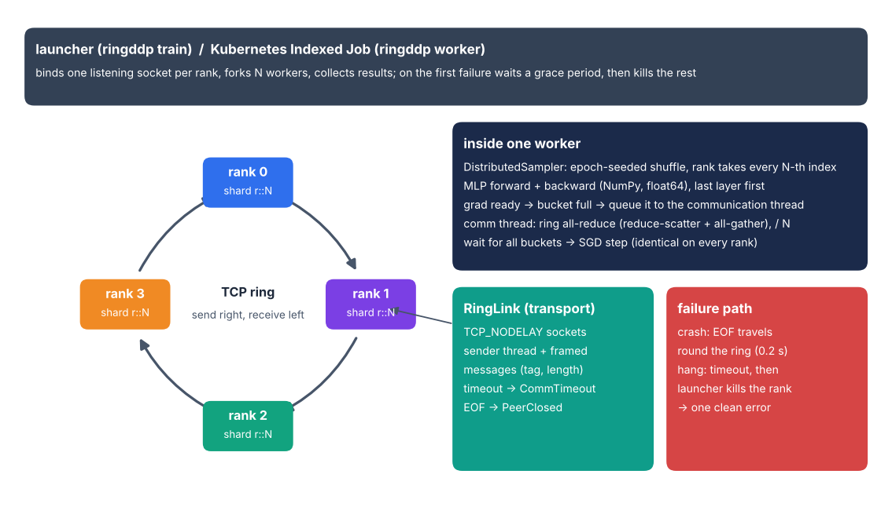
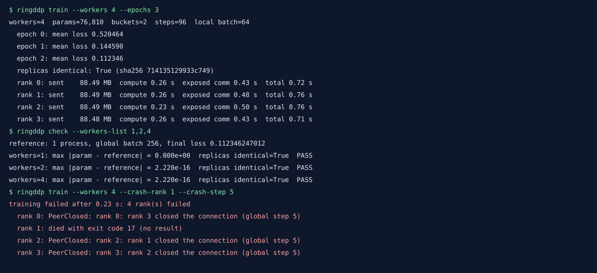

# ringddp: Data-Parallel Training from Scratch with Ring All-Reduce

A small, complete implementation of distributed data-parallel (DDP) training in pure Python and NumPy.
N worker processes each hold a full copy of an MLP, train on a disjoint shard of every batch, and average
their gradients with a **ring all-reduce written from scratch over TCP sockets** (reduce-scatter + all-gather).
Gradients are grouped into **buckets** that are all-reduced on a background thread **while the backward pass is
still running**, exactly like PyTorch DDP. The result is proven bit-for-bit equal (within 2.2e-16) to
single-process training, and every byte on the wire is checked against the `2(N-1)/N x S` formula.

## Overview, objectives and key features

Objectives:

- Show exactly what `torch.nn.parallel.DistributedDataParallel` + NCCL/gloo do, with nothing hidden.
- Prove correctness (N workers == 1 process) and communication cost (bytes == theory) with tests.
- Measure scaling for 1, 2 and 4 workers and the effect of bucketing and overlap.
- Fail loudly and quickly when a worker crashes or hangs, instead of hanging forever.

Key features:

| Feature | Where |
|---|---|
| Ring all-reduce: reduce-scatter (N-1 steps) + all-gather (N-1 steps) | `src/ringddp/allreduce.py` |
| TCP ring links with framed, tagged messages, a sender thread, timeouts | `src/ringddp/transport.py` |
| Gradient buckets (gradient-as-bucket-view), overlap with backward | `src/ringddp/ddp.py` |
| Distributed sampler: disjoint shards, per-epoch shuffle, padding / drop_last | `src/ringddp/sampler.py` |
| NumPy MLP with per-tensor "gradient ready" hooks, SGD with momentum | `src/ringddp/model.py` |
| Launcher: N processes, result collection, crash/hang detection | `src/ringddp/launch.py` |
| Equivalence check vs single process, benchmarks, alpha-beta projection | `src/ringddp/cli.py`, `bench.py`, `costmodel.py` |
| Multi-host mode (one process per pod) + Kubernetes Indexed Job | `ringddp worker`, `deploy/k8s/ringddp-job.yaml` |

## Architecture



Each rank connects to its right neighbour and accepts a connection from its left neighbour. Backward produces
gradients from the last layer to the first; when every gradient of a bucket is ready, the bucket is queued to the
communication thread, which runs the ring all-reduce and divides by N. The optimizer steps only after all
buckets are done, so every replica applies the same averaged gradient.

## Tech stack

- Python 3.10+ and NumPy (float64) only; `socket`, `threading`, `multiprocessing` from the standard library
- pytest for tests; matplotlib only to draw the docs images
- Docker (python:3.12-slim), Kubernetes Indexed Job + headless Service
- GitHub Actions CI; an optional job compares against `torch.distributed` (gloo) on CPU

## Project structure

```
3.1-ddp-ring-allreduce/
|-- src/ringddp/
|   |-- allreduce.py     # chunk_bounds, ring_allreduce, ring_bytes_per_rank
|   |-- transport.py     # RingLink: TCP ring, framed messages, timeouts, byte counters
|   |-- model.py         # MLP with gradient-ready hooks, SGD with momentum
|   |-- ddp.py           # DistributedDataParallel: buckets + communication thread
|   |-- sampler.py       # DistributedSampler
|   |-- trainer.py       # Config, data, train_worker, train_reference
|   |-- launch.py        # launch N processes, WorkerFailure
|   |-- bench.py         # all-reduce, scaling, overlap benchmarks
|   |-- costmodel.py     # alpha-beta model, fit, GPU projection
|   |-- cli.py  __main__.py
|-- tests/               # 6 files, 29 tests (+1 optional torch test)
|-- bench/torch_allreduce.py   # same measurement with torch.distributed (gloo / nccl)
|-- deploy/k8s/ringddp-job.yaml
|-- docs/architecture.png  docs/demo.png
|-- results/             # benchmark JSON written by `make bench`
|-- Dockerfile  .dockerignore  Makefile  pyproject.toml  LICENSE
```

## Installation guide

Local:

```bash
git clone https://github.com/tahsin-ts/part3-12 && cd part3-12/3.1-ddp-ring-allreduce
pip install -e ".[test]"
make test        # 29 tests, ~10 s
make demo        # train, equivalence check, crash demo, projection
make bench       # writes results/*.json (~2 min on 2 cores)
```

Docker:

```bash
docker build -t ringddp:latest .
docker run --rm ringddp:latest check --workers-list 1,2,4
docker run --rm ringddp:latest train --workers 4 --epochs 3
```

Kubernetes (4 pods, one rank each):

```bash
kubectl apply -f deploy/k8s/ringddp-job.yaml
kubectl logs -l job-name=ringddp --prefix
```

## Demo



```
$ ringddp check --workers-list 1,2,4
reference: 1 process, global batch 256, final loss 0.112346247012
workers=1: max |param - reference| = 0.000e+00  replicas identical=True  PASS
workers=2: max |param - reference| = 2.220e-16  replicas identical=True  PASS
workers=4: max |param - reference| = 2.220e-16  replicas identical=True  PASS
```

## Selected code samples

The whole ring all-reduce (`src/ringddp/allreduce.py`):

```python
for k in range(n - 1):                         # reduce-scatter
    send_c, recv_c = (r - k) % n, (r - k - 1) % n
    link.send(view(send_c), tag + k)
    view(recv_c)[:] += link.recv(b[recv_c][1] - b[recv_c][0], tag + k)
for k in range(n - 1):                         # all-gather
    send_c, recv_c = (r - k + 1) % n, (r - k) % n
    link.send(view(send_c), tag + n + k)
    view(recv_c)[:] = link.recv(b[recv_c][1] - b[recv_c][0], tag + n + k)
```

Starting communication from inside backward (`src/ringddp/ddp.py`):

```python
def _on_grad(self, i):
    b = self.bucket_of[i]
    b.pending -= 1
    if b.pending == 0 and self.overlap:
        self._q.put(b)          # all-reduce this bucket while backward continues
```

## Benchmark summary

All numbers below were **measured** on a shared 2-core x86 VM (Python 3.13, NumPy, loopback TCP), best of 3 repeats
(`make bench`). GPU numbers are **PROJECTED** from an alpha-beta model, not measured.

Ring all-reduce, bytes sent by one rank vs theory `2(N-1)/N x S` (exact match for every size):

| N | message S | sent by each rank | theory | median time |
|---|---|---|---|---|
| 2 | 32 MB | 32.0 MB | 32.0 MB | 27.3 ms |
| 4 | 32 MB | 48.0 MB | 48.0 MB | 111.4 ms |

Training (MLP 32-512-512-10, 16,384 samples, global batch 512, 1 epoch; same final loss 0.4032 for every N):

| workers | wall time | samples/s | exposed comm |
|---|---|---|---|
| 1 | 0.59 s | 27,680 | - |
| 2 | 0.43 s | 37,770 (1.36x) | 0.04 s |
| 4 | 0.81 s | 20,280 | 0.36 s (4 processes on 2 cores) |

Bucketing and overlap (2 workers, 6 hidden layers of 512, 1.34 M parameters), per step:

| buckets | overlap | step | exposed comm |
|---|---|---|---|
| 1 (all grads) | no | 74.6 ms | 18.0 ms |
| 256 KiB (6 buckets) | yes | 64.8 ms | 4.8 ms |

PROJECTED (alpha-beta model, `ringddp project`; assumptions: 8 ranks, NVLink 300 GB/s per direction at 77%,
alpha 5 us; 100 GbE 12.5 GB/s at 80%, alpha 25 us; bf16/fp32 gradients):

| model | gradient bytes | 8x A100 NVLink | 8 nodes, 100 GbE |
|---|---|---|---|
| ResNet-50 (fp32) | 0.10 GB | 0.8 ms | 18.3 ms |
| BERT-large (fp32) | 1.36 GB | 10.4 ms | 238 ms |
| Llama-2-7B (bf16) | 13.5 GB | 102 ms | 2.36 s |

Measure on real GPUs: `torchrun --nproc_per_node 8 bench/torch_allreduce.py --backend nccl --sizes-mb 100,1000,13480`.

## Test summary

29 tests (plus 1 that runs only when PyTorch is installed) in 6 files:

| File | Covers |
|---|---|
| `test_allreduce.py` | chunking; correct sum and bitwise-identical replicas for N = 2..5 (uneven and tiny arrays); bytes == 2(N-1)/N x S for N = 2, 3, 4, 8 |
| `test_ddp.py` | backward vs finite differences; bucket order and gradient views; N = 2, 4 workers == 1 process (1e-12); bucket size/overlap do not change the result; bytes per worker == theory |
| `test_sampler.py` | disjoint shards covering the dataset; per-epoch shuffle; padding and drop_last; global batch == single-process batch |
| `test_failure.py` | crash reported by every rank; hung worker times out and is killed; bad batch size; missing peer at start-up |
| `test_costmodel_cli.py` | alpha-beta fit; projection numbers; `check`, `project`, `train` CLI; `worker` mode as separate OS processes |
| `test_torch_reference.py` | (optional) same gradients and all-reduce result as `torch.distributed` gloo |

```
PYTHONPATH=src python3 -m pytest -v
...
tests/test_sampler.py::test_shards_are_disjoint_and_cover_the_dataset PASSED [ 89%]
tests/test_sampler.py::test_new_shuffle_every_epoch_same_on_every_rank PASSED [ 93%]
tests/test_sampler.py::test_padding_and_drop_last PASSED                 [ 96%]
tests/test_sampler.py::test_global_batch_is_the_same_set_as_single_process PASSED [100%]

======================== 29 passed, 1 skipped in 3.75s =========================
```

## Learning outcomes

- Implement reduce-scatter and all-gather and explain why each rank sends `2(N-1)/N x S` bytes, independent of N.
- Explain why N workers with a global batch B give the same model as one process with batch B (and when they do not).
- Build gradient buckets, hook them into the backward pass and overlap communication with computation.
- Shard a dataset correctly across ranks (shuffle per epoch, padding, drop_last).
- Detect crashed and hung peers with timeouts and fail the whole job quickly.
- Use an alpha-beta model to predict all-reduce time on real interconnects.

## License

MIT License. Copyright (c) 2026 Tahsin Shahrear. See [LICENSE](LICENSE).
