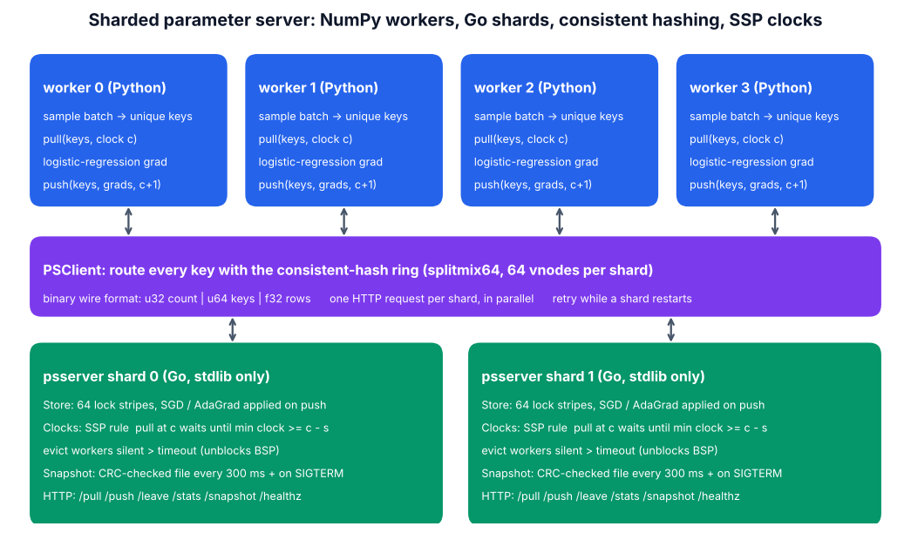
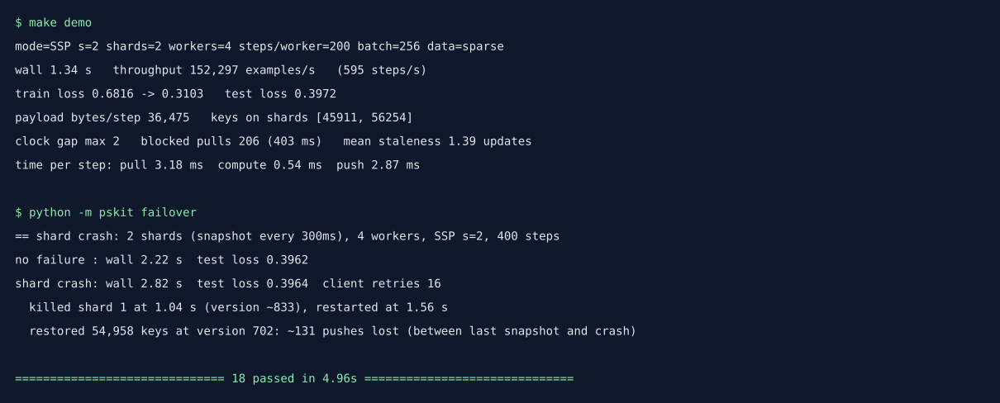

# Sharded Parameter Server (Go shards + NumPy workers)

A working parameter server for sparse models: model weights are split across Go shard servers with consistent hashing,
Python/NumPy workers pull only the rows they need, compute gradients and push them back, and the shards apply AdaGrad or
SGD. Workers can run fully synchronous (BSP), with bounded staleness (SSP) or fully asynchronous. Shards snapshot to disk and
restart without losing the model; dead workers are evicted so synchronous training never hangs.

## 2. Overview, objectives and key features

**Objectives**
- Show how large sparse models (ads click-through, recommendation embeddings) are trained when the model is bigger than one machine.
- Make the consistency trade-off measurable: wait for everyone (BSP), allow a bounded lead (SSP), or never wait (async).
- Compare the parameter-server pattern with ring all-reduce and show when each one wins.

**Key features**
- `psserver` (Go, standard library only): sharded key -> float32-row store with 64 lock stripes, optimizer applied on push.
- Stale Synchronous Parallel clocks: a pull at clock `c` waits until every live worker reached `c - s`.
- Consistent-hash ring (splitmix64, 64 virtual nodes per shard), bit-for-bit identical in Go and Python (shared test vectors).
- Compact binary wire format (u32 count | u64 keys | f32 rows) over HTTP; client retries while a shard restarts.
- Failure handling: CRC-checked snapshots (periodic + on SIGTERM), worker eviction after a timeout, wrong-ring requests rejected.
- Benchmarks: consistency modes, sparse vs dense traffic, scaling with workers and shards, delayed-gradient simulator,
  consistent vs modulo hashing, PS vs ring all-reduce cost model.
- Docker image (one image for shards and workers) and Kubernetes manifests (StatefulSet + Indexed Job).

## 3. Architecture



1. A worker samples a batch, collects the unique feature ids (keys) and asks `PSClient` to pull them at its clock `c`.
2. The client splits keys by owner shard on the hash ring and sends one request per shard in parallel.
3. Each shard waits (SSP rule) until the slowest live worker is at most `s` clocks behind, then answers with the rows.
4. The worker computes the logistic-regression gradient for those rows and pushes it with clock `c + 1`; the shard applies AdaGrad.

## 4. Tech stack

| Layer | Technology |
|---|---|
| Shard server | Go 1.24, standard library only (`net/http`, `sync`, `hash/crc32`) |
| Workers, client, benchmarks | Python 3.10+, NumPy |
| Tests | `go test -race`, pytest |
| Packaging | Docker multi-stage build, Kubernetes StatefulSet + Indexed Job |
| CI | GitHub Actions (gofmt, vet, race tests, pytest, demo, docker smoke test) |

## 5. Project structure

```
3.2-parameter-server/
|-- cmd/psserver/main.go        # flags, snapshot loop, eviction loop, graceful shutdown
|-- internal/ps/
|   |-- store.go                # striped key -> row store, SGD / AdaGrad
|   |-- clock.go                # SSP clocks, waiting, eviction
|   |-- hashring.go             # consistent hashing (splitmix64 + vnodes)
|   |-- codec.go                # binary wire format
|   |-- snapshot.go             # CRC-checked snapshots
|   |-- server.go               # HTTP handlers: /pull /push /leave /reset /snapshot /stats /healthz
|   `-- *_test.go               # 14 Go tests
|-- pskit/
|   |-- client.py  codec.py  hashring.py   # client side of the protocol
|   |-- worker.py  model.py  data.py       # training worker, sparse logistic regression, synthetic data
|   |-- cluster.py                         # start shards, run worker processes, collect stats
|   |-- sim.py  allreduce.py               # staleness simulator, ring all-reduce + cost model
|   `-- cli.py                             # python -m pskit {train,worker,bench,sim,ring,compare,failover}
|-- tests/                      # 18 pytest tests
|-- deploy/k8s/psserver.yaml  workers-job.yaml
|-- docs/architecture.png  demo.png
|-- Dockerfile  .dockerignore  Makefile  go.mod  LICENSE
```

## 6. Installation

Local (Go 1.24 and Python 3.10+):

```
pip install numpy pytest
make build          # go build -o bin/psserver ./cmd/psserver
make test           # go vet + go test -race + pytest
make demo           # 2 shards + 4 workers, SSP s=2
make bench          # consistency modes, traffic, scaling, simulator, hashing, PS vs all-reduce
make drills         # shard crash + restart from snapshot; worker death
```

Docker:

```
docker build -t paramserver:latest .
docker run --rm --entrypoint python paramserver:latest -m pskit train --steps 50
```

Kubernetes (any cluster; the image must be pullable by the nodes):

```
kubectl apply -f deploy/k8s/psserver.yaml      # StatefulSet ps-0, ps-1 with snapshot volumes
kubectl apply -f deploy/k8s/workers-job.yaml   # Indexed Job: 4 workers, ids from JOB_COMPLETION_INDEX
```

## 7. Demo



Real output of `make demo`, the shard-crash drill and the test suite on a 2-core CPU machine.

## 8. Selected code samples

The SSP rule on the shard (`internal/ps/clock.go`):

```go
for {
    m := c.minLocked()               // slowest live worker
    if s < 0 || m >= clk-s {         // async, or close enough: answer now
        ...
        return nil
    }
    ch := c.changed                  // closed whenever any clock moves
    c.mu.Unlock()
    select { case <-ch: case <-timer.C: ...; case <-ctx.Done(): ... }
    c.mu.Lock()
}
```

One training step on a worker (`pskit/worker.py`):

```python
idx = rng.choice(mine, batch, replace=False)
uniq, g, loss = batch_grad(keys[idx], y[idx], pull)   # pull(uniq) -> rows at clock c
cl.push(uniq, g, clock=c + 1)                          # shards apply AdaGrad
```

## 9. Benchmark summary (measured on a 2-core CPU VM, localhost)

| Consistency (2 shards, 4 workers, 300 steps, batch 256) | examples/s | test loss | max clock gap | blocked pulls |
|---|---|---|---|---|
| sync (BSP) | 160,082 | 0.3965 | 0 | 844 |
| SSP s=1 | 186,550 | 0.3966 | 1 | 498 |
| SSP s=3 | 213,890 | 0.3966 | 3 | 342 |
| async | 155,230 | 0.3966 | 11 | 0 |

- Sparse data: each step pulls 1,584 of 96,816 keys (1.6% of the model), 36,480 payload bytes per step.
- Consistent hashing, 4 -> 5 shards: 23.3% of keys move (ideal 20%); modulo hashing moves 80.0%.
- Delayed-gradient simulator: SGD lr=2.0 degrades from test loss 0.1544 (delay 0) to 0.6229 (delay 16); AdaGrad stays within 0.163-0.172.
- Shard crash drill: shard killed with SIGKILL, restarted from its last snapshot after 0.5 s; training finished with test loss 0.3964 vs 0.3962 without failure.
- Cost model (not a measurement): for a 1 B-parameter dense model ring all-reduce needs 560 ms per step vs 641 ms for the PS on
  8 x 100 Gb/s; for a 10 B-key click model touching 400 k keys the PS needs 0.85 ms vs 5,600 ms. These are PROJECTED from an
  alpha-beta model, not measured on a cluster.

Throughput numbers on 2 CPU cores are noisy (workers, shards and the OS share the same cores); compare modes within one run.

## 10. Test summary

32 tests, all passing: 14 Go tests (`go test -race`) and 18 pytest tests.

| Area | What is tested |
|---|---|
| Store | SGD and AdaGrad updates; 8 goroutines pushing concurrently (race detector) |
| Clocks | BSP waits for the slowest worker; SSP allows exactly `s` clocks of lead; evicting a dead worker unblocks the rest |
| Hash ring | identical owners in Go and Python (shared vectors); balance; minimal movement when a shard is added |
| Codec | round trip; malformed messages rejected |
| Server | push/pull/stats over HTTP; BSP over HTTP; restart from snapshot; corrupt snapshot rejected |
| Cluster | training converges under BSP, SSP and async and respects the bound; wrong ring rejected; shard crash + restart; dead worker evicted |
| Maths | gradient vs finite differences; ring all-reduce correct with 2(n-1)/n bytes; large staleness hurts SGD |

```
$ go vet ./... && go test -race -count=1 ./...
ok  	github.com/tahsin-ts/part3-12/3.2-parameter-server/internal/ps	1.317s
$ python -m pytest -q
18 passed in 4.96s
```

## 11. Learning outcomes

- Why sparse models use parameter servers and dense models use all-reduce, with the byte counts to prove it.
- Bounded staleness: how BSP, SSP and async trade waiting time against gradient freshness.
- Consistent hashing with virtual nodes and why `key % n` is a bad sharding function.
- Lock striping, binary protocols and request routing in Go.
- Failure handling in stateful services: snapshots, restart, retries, eviction, and what is lost between snapshots.
- Deploying stateful shards with a StatefulSet and workers with an Indexed Job.

## 12. License

MIT License. Copyright (c) 2026 Tahsin Shahrear. See [LICENSE](LICENSE).
