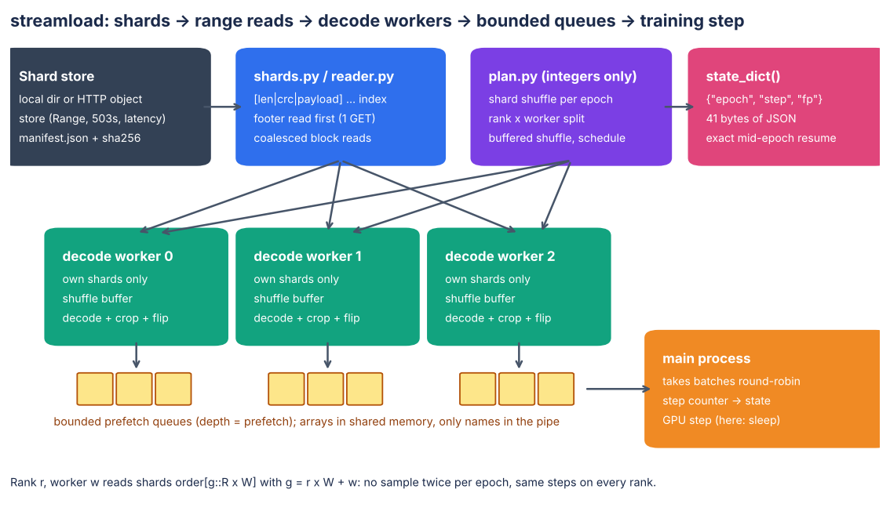
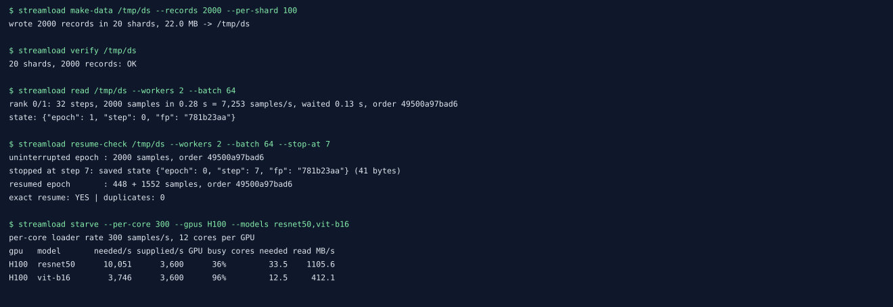

# streamload: a high-throughput streaming data loader

`streamload` feeds training jobs from sharded datasets that live on local disk or in an HTTP object store
(S3-style range requests). It decodes in worker processes, prefetches into bounded queues, shuffles with a
bounded buffer, splits data across data-parallel ranks without duplicates, and can stop and resume **exactly**
in the middle of an epoch from a 41-byte state.

## Overview, objectives and key features

Objectives: never let the accelerator wait for data, never read a sample twice per epoch on any rank, and make
a restarted job see exactly the batches it would have seen without the restart.

- **Shard format with integrity:** `[magic][len|crc32|payload]... [offset index] [footer]`; a crc32 per record,
  a crc32 for the index, and a sha256 per shard in `manifest.json`.
- **Two stores, one interface:** `LocalStore` (files) and `HttpStore` (keep-alive HTTP, `Range` reads, retries with
  exponential back-off). `ObjectStoreServer` simulates an object store with latency, jitter, bandwidth limits and
  injected 503 errors.
- **Streaming reader:** footer + index in one tail read, then records in large coalesced range reads (1 MiB default).
- **Multi-process decode:** N worker processes, each with a bounded queue (`prefetch`); image arrays travel through
  shared memory, only their names through the pipe.
- **Shuffling:** shards are shuffled per epoch; samples are shuffled with a bounded buffer per worker.
- **Rank and worker sharding:** global worker `g = rank x workers + worker` takes shards `order[g::world x workers]`;
  every rank runs the same number of steps.
- **Exact deterministic resume:** the whole epoch plan is a pure function of integers; state is
  `{"epoch", "step", "fp"}`; workers fast-forward without reading data and refill their buffers by random access.
- **Augmentation keyed by sample**, so results do not depend on the number of workers.
- **Benchmarks** of throughput vs workers, prefetch depth, record size and remote block size, plus a
  "is the GPU starved?" calculator.

## Architecture



Shards -> `ShardReader` (footer, index, coalesced range reads) -> per-worker shuffle buffer -> decode and augment ->
bounded queue -> main process takes batches round-robin in a planned order -> training step.

## Tech stack

Python 3.10+, NumPy, multiprocessing (forkserver, shared memory), `http.server` / `http.client` (stdlib),
Pillow (optional, JPEG), pytest, Docker, Kubernetes, GitHub Actions, matplotlib (docs only).

## Project structure

```
3.3-streaming-data-loader/
|-- src/streamload/
|   |-- shards.py     # record format, writer, manifest, checksums
|   |-- storage.py    # LocalStore, HttpStore (Range + retries), ObjectStoreServer
|   |-- reader.py     # ShardReader: footer -> index -> streamed records
|   |-- codec.py      # synthetic images, raw/zlib/JPEG codecs, augmentation
|   |-- plan.py       # shard shuffle, rank/worker split, buffered shuffle, schedule
|   |-- loader.py     # StreamingLoader: workers, prefetch queues, state_dict
|   |-- bench.py      # throughput sweeps
|   |-- starve.py     # needed vs supplied samples/s per GPU
|   `-- cli.py        # streamload make-data | serve | verify | read | resume-check | bench | starve
|-- tests/            # 31 tests
|-- scripts/make_docs.py
|-- deploy/k8s/streamload.yaml
|-- docs/architecture.png  docs/demo.png
|-- Dockerfile  Makefile  pyproject.toml  LICENSE
```

## Installation

Local:

```bash
pip install -e ".[test]"        # numpy, pillow, pytest
make test
make demo                       # writes /tmp/streamload-data, reads it, checks exact resume
```

Remote store simulator:

```bash
streamload serve /tmp/streamload-data --port 8000 --latency-ms 5 --fail-every 25 &
streamload read http://127.0.0.1:8000 --workers 2 --batch 64
```

Docker:

```bash
docker build -t streamload .
docker run --rm --entrypoint sh streamload -c "streamload make-data /data/ds && streamload resume-check /data/ds"
```

Kubernetes: `kubectl apply -f deploy/k8s/streamload.yaml` starts a shard store and a 2-rank Indexed Job that reads from it.

## Demo



```
$ streamload resume-check /tmp/streamload-data --workers 2 --batch 64 --stop-at 7
uninterrupted epoch : 2000 samples, order 49500a97bad6
stopped at step 7: saved state {"epoch": 0, "step": 7, "fp": "781b23aa"} (41 bytes)
resumed epoch       : 448 + 1552 samples, order 49500a97bad6
exact resume: YES | duplicates: 0
```

## Selected code samples

Exact resume needs no data, only integers: fast-forward the shuffle, then refill the buffer by random access.

```python
order = buffered_shuffle(n, cfg["shuffle_buffer"], plan.rng(worker))
emitted, n_read = set(), 0
for _ in range(sum(sizes[:start_batch])):   # fast-forward on integers only
    p, n_read = next(order)
    emitted.add(p)
pending = {p: get(p) for p in range(n_read) if p not in emitted}
```

No duplicates across ranks and workers:

```python
def assign_shards(order, world_size, rank, num_workers, worker):
    g, total = rank * num_workers + worker, world_size * num_workers
    return order[g::total]
```

## Benchmark summary

Measured on a shared 2-core CPU VM (`streamload bench`; numbers vary with machine load):

| Experiment | Setting | Result |
|---|---|---|
| JPEG decode + 224 crop (500x375, 65 kB) | 1 core | 753 samples/s |
| Decode workers | 0 / 1 / 2 / 3 processes | 645 / 594 / 778 / 840 samples/s |
| Transfer to main process | float32 instead of uint8 | 882 -> 531 samples/s |
| Remote store, 5 ms latency, 3 kB records | 1 request per record -> 1 MiB block reads | 177 -> 9,170 samples/s (1,032 -> 16 requests) |
| Record size, local disk | 0.8 kB -> 192 kB | 206 -> 583 MB/s |

GPU numbers are **PROJECTED**, not measured: `streamload starve` uses datasheet dense BF16 peaks
(A100 312, H100 989 TFLOP/s), an assumed MFU (ResNet-50 25%, ViT-B/16 40%) and training FLOPs = 3 x forward.
With 12 cores per GPU at 753 samples/s per core, an H100 training ResNet-50 needs about 10,051 images/s and the
loader supplies about 9,036: the GPU would be at most ~90% busy.

## Test summary

31 tests: record format round trip, corrupt record / footer / index detection, manifest sha256; HTTP range reads,
keep-alive, retries after injected 503s, request coalescing; buffered shuffle is a bounded permutation; no duplicates
across ranks and workers; equal steps per rank; processes equal inline results; exact resume mid-epoch (inline,
processes, over HTTP); state from a different configuration is rejected; worker exceptions reach the main process;
CLI end to end.

```
...............................                                          [100%]
31 passed in 4.04s
```

## Learning outcomes

- Designing a record format that supports both streaming and random access, with checksums at every level.
- Hiding object-store latency with request coalescing and parallel streams.
- Bounded prefetch and back-pressure between producer processes and a consumer.
- Why a shuffle buffer is not a full shuffle, and how shard shuffling makes up for it.
- Making a data pipeline a pure function of (seed, epoch, step) so that resume is exact.
- Sizing a CPU input pipeline against an accelerator's appetite.

## License

MIT License. Copyright (c) 2026 Tahsin Shahrear. See [LICENSE](LICENSE).
