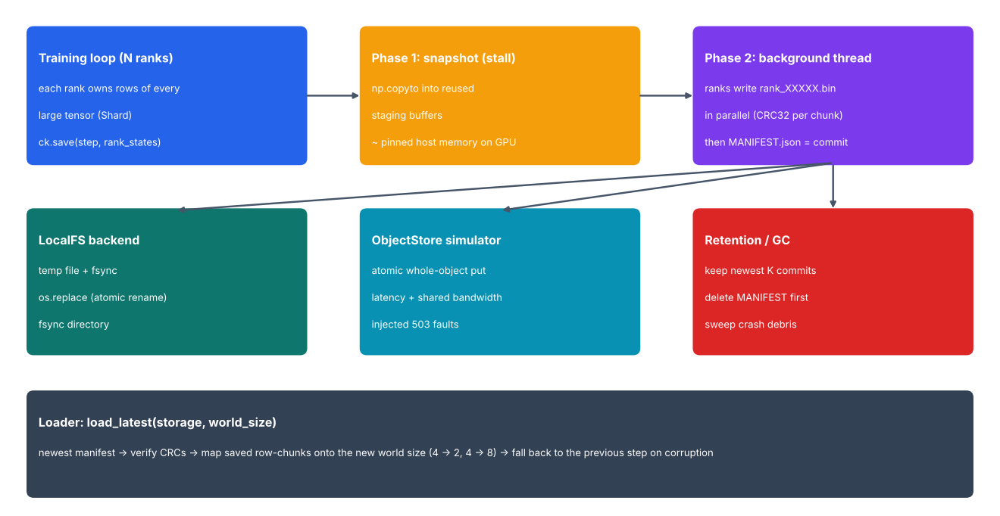
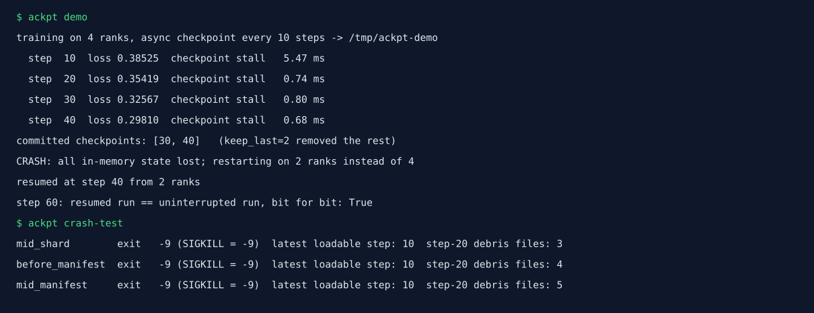

# ackpt: Asynchronous Distributed Checkpointing

A small, complete checkpointing library for sharded training state. Each rank saves its own shard of the
model and optimizer state; training pauses only for a fast in-memory snapshot while a background thread
writes the files; a manifest written last makes the checkpoint appear atomically; CRC32 checksums catch
corruption; and a checkpoint saved by 4 ranks loads onto 2, 3 or 8 ranks. Pure Python + NumPy.

## Overview, objectives and key features

Large training jobs fail every few hours. Each failure loses the work since the last checkpoint, and each
synchronous checkpoint pauses every GPU. This project shows how production checkpointers
(PyTorch Distributed Checkpoint `async_save`, Megatron, Orbax) remove most of that pause and stay correct
when a process is killed in the middle of a write.

- **Two-phase async save**: phase 1 copies shards into reused staging buffers (the only stall); phase 2 writes in a background thread, one writer per rank, with back-pressure (one save in flight).
- **Atomic commit**: shard files first, `MANIFEST.json` last. LocalFS uses temp file + `fsync` + `os.replace` + directory `fsync`; the object store relies on atomic whole-object puts.
- **Integrity**: CRC32 per chunk, a checksum over the manifest itself, automatic fallback to the previous checkpoint.
- **Resharding on load**: saved row-chunks are mapped onto any new world size; each rank can read only its own rows (ranged reads).
- **Retention and GC**: keep the newest K commits, delete the manifest first, sweep debris of crashed saves.
- **Object-store simulator**: per-request latency, shared bandwidth, injected `503` errors.
- **Crash injection**: a real child process is killed with `SIGKILL` at three points of a save; the previous checkpoint must still load.
- **Planning**: checkpoint size and time for large models, and the Young/Daly checkpoint interval.

## Architecture



```
step_000000040/rank_00000.bin ... rank_00003.bin    raw tensor bytes, one file per rank
step_000000040/MANIFEST.json                        written last: the commit point
```

## Tech stack

Python 3.10+, NumPy, `threading` + `concurrent.futures`, `zlib.crc32`, pytest, matplotlib (docs only),
Docker, Kubernetes CronJob, GitHub Actions.

## Project structure

```
3.4-async-checkpointing/
|-- ackpt/
|   |-- state.py         # Shard, row ranges, shard_state / unshard, a model + Adam state
|   |-- storage.py       # LocalFS (fsync + rename) and ObjectStore simulator
|   |-- manifest.py      # rank file encoding, manifest with checksums
|   |-- checkpointer.py  # two-phase async save, back-pressure, error propagation
|   |-- loader.py        # committed steps, verify, reshard, load_latest with fallback
|   |-- retention.py     # keep-last-K and garbage collection
|   |-- train.py         # deterministic NumPy MLP + Adam (for resume tests)
|   |-- planning.py      # sizes, write times, Young/Daly
|   |-- crashsim.py      # child process killed with SIGKILL mid-save
|   |-- bench.py  cli.py  __main__.py
|-- tests/               # 44 tests
|-- docs/                # architecture.png, demo.png, make_figures.py
|-- deploy/k8s/ckpt-gc-cronjob.yaml
|-- Dockerfile  .dockerignore  Makefile  pyproject.toml  LICENSE
```

## Installation

Local:

```bash
pip install numpy pytest
make test      # 44 tests
make demo      # train, checkpoint, "crash", resume on 2 ranks, compare bit for bit
make bench     # stall, throughput, recovery
make crash     # SIGKILL a writer at three points
```

Docker:

```bash
docker build -t ackpt .
docker run --rm -v $PWD/ckpt:/ckpt ackpt            # demo into ./ckpt
docker run --rm -v $PWD/ckpt:/ckpt ackpt verify /ckpt
```

## Demo



## Selected code samples

Commit protocol (checkpointer.py):

```python
with ThreadPoolExecutor(max_workers=self.world) as ex:          # ranks write in parallel
    results = list(ex.map(lambda r: self._write_rank(step, r, snap[r]), range(self.world)))
man = build_manifest(step, self.world, [c for c, _ in results], extra)
self.storage.put(f"{step_dir(step)}/{MANIFEST}", man)           # COMMIT: last, atomic
```

Atomic file write (storage.py):

```python
f.write(data); f.flush(); os.fsync(f.fileno())   # data is on disk before it gets its real name
os.replace(tmp, path)                            # readers see old or new, never half
os.fsync(dir_fd)                                 # the rename itself survives a power cut
```

## Benchmark summary

Measured on a 2-core cloud VM, 48 MB of state (4M parameters x weight, Adam m, v), 4 ranks (`make bench`):

| Backend | Mode | Stall per checkpoint | Write time | Write MB/s |
|---|---|---|---|---|
| local disk, fsync | sync | 96.5 ms | 67.1 ms | 716 |
| local disk, fsync | async | 8.9 ms | 67.5 ms | 712 |
| object store sim, 200 MB/s, 20 ms | sync | 439.6 ms | 310.0 ms | 155 |
| object store sim, 200 MB/s, 20 ms | async | 12.3 ms | 295.0 ms | 163 |

Training run, 40 steps, checkpoint every 10 steps to the object-store simulator (median of 3):
no checkpoints 1.91 s; sync 3.62 s (1.49 s stalled); async 2.82 s (0.04 s stalled). Async stalls about
37x less than sync; the background writer still competes for the 2 CPU cores (encoding and CRC), so the
run is not as fast as with no checkpoints at all. Recovery (find newest, read, verify CRC, reshard 4 -> 2):
36.5 ms from local disk, 1.64 s from the object-store simulator.

**PROJECTED (not measured)** with `ackpt plan`: 7B parameters x 14 bytes = 98 GB per full checkpoint,
~33 s to one node's NVMe at 3 GB/s; 70B = 980 GB, ~49 s to S3 from 8 nodes at 2.5 GB/s each.
Bandwidths are assumptions; measure yours with `fio` and your object-store client.

## Test summary

44 tests, all passing (`python -m pytest -q` -> `44 passed`):

- save/load round trips on both backends, sync and async;
- resharding 4->2, 4->8, 4->3, 3->4, 2->1, 1->6 (every rank gets exactly its new rows);
- the async snapshot is isolated from in-place updates after `save()` returns;
- manifest written last; staging buffers reused; only one save in flight; background errors re-raised;
- bit flips in shards and in the manifest, truncated and missing files: detected, previous checkpoint loaded;
- a single rank reads about 1/8 of the bytes when loading onto 8 ranks;
- real `SIGKILL` mid-shard, before the manifest and mid-manifest: step 10 loads, GC removes the debris;
- retention: keep-last, manifest deleted first, in-flight steps protected;
- resumed training (on a different world size) is bit-identical to an uninterrupted run;
- planning formulas; object-store bandwidth and fault injection; CLI.

## Learning outcomes

- Why a checkpoint needs a commit point, and how `fsync` + `rename` provide one on POSIX.
- How async checkpointing hides write time and what it still costs (snapshot memory, CPU contention).
- How to reshard state between different world sizes using row-range overlaps.
- How to detect silent corruption and fall back safely.
- How to choose a checkpoint interval from failure rate and checkpoint cost (Young/Daly).

## License

MIT. Copyright (c) 2026 Tahsin Shahrear. See [LICENSE](LICENSE).
