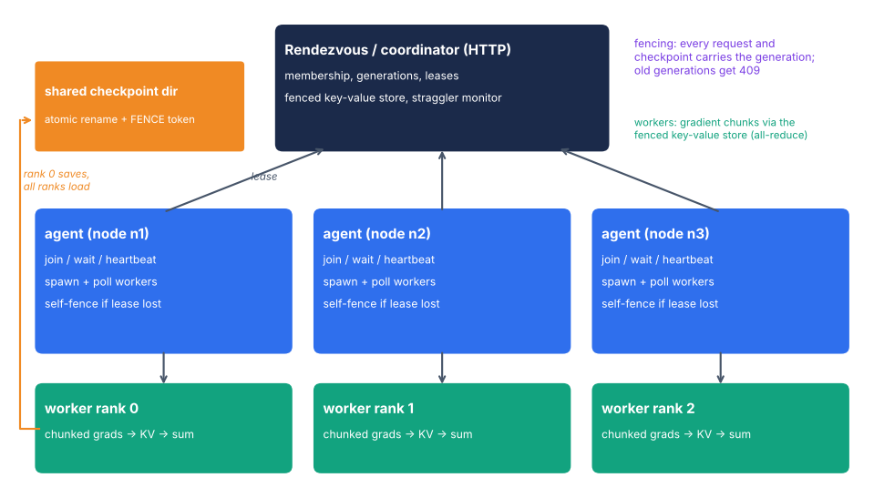
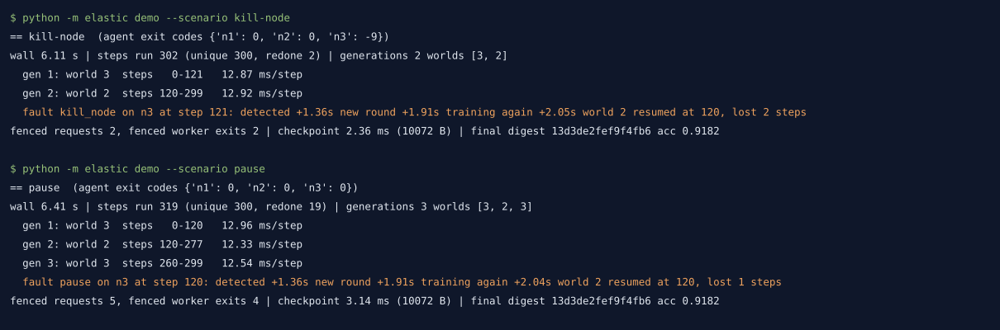

# elastic-train: Fault-Tolerant Elastic Data-Parallel Training

`elastic-train` keeps a data-parallel training job alive while machines die, freeze, lose the network,
slow down or join late. It is a small, readable re-implementation of the ideas behind PyTorch's
`torchrun` elastic agent: a **rendezvous** with **generations, heartbeats and leases**, one **agent** per node
that restarts its workers at whatever **world size** is available, **fenced** atomic checkpoints, and an
**exact resume**: after any fault the final weights are bit-for-bit the same as a run that never failed.

Everything runs on one CPU machine with real processes, real `kill -9` and real `SIGSTOP`.

## Overview, objectives and key features

Objectives:
- Show exactly how an elastic training job detects a failure, agrees on a new membership and resumes.
- Measure detection time, recovery time and lost work for each kind of fault, instead of guessing them.
- Prove that shrinking or growing the job does not change the maths (same final weights for any world size).

Key features:
- **Rendezvous state machine** (`rendezvous.py`): OPEN -> RUNNING -> DONE, `min_nodes` / `max_nodes`, a last-call
  timer, ranks assigned in node order, hot spares, scale-up when a node arrives and there is room.
- **Leases and heartbeats**: each node's lease lasts `lease_ttl` seconds; a node that stops renewing it is dropped and a
  new generation starts. Waiting spares keep their lease alive by long polling.
- **Generations and fencing**: every key-value request and every checkpoint carries the generation number; stale
  generations get HTTP 409 and stale checkpoint writers are refused (`FENCE` token), so a frozen "zombie" node
  cannot corrupt the new group.
- **Node agent** (`agent.py`): join, spawn `nproc` workers, poll them, heartbeat, stop and re-rendezvous on any change,
  **self-fence** (kill its own workers) when it cannot renew its lease, restart budget.
- **World-size-invariant training** (`model.py`): the global batch is cut into 8 fixed chunks; ranks own chunks
  round-robin and everyone adds them in chunk order, so 3 workers and 2 workers produce identical bits.
- **Atomic, verified checkpoints** (`checkpoint.py`): temp file + fsync + rename, `LATEST` with SHA-256, fall back to an
  older file if the newest is corrupt, keep the last 3.
- **Fault injection** (`cluster.py`): kill a worker, kill a whole node, network partition, SIGSTOP pause, slow node
  (straggler) with optional eviction, scale-up.
- **Measurements** from one shared JSON-lines event log: detection, new round, training again, lost steps, goodput.

## Architecture



| Module | Role |
|---|---|
| `rendezvous.py` | Membership, generations, leases, fenced key-value store, straggler monitor (pure logic, injectable clock) |
| `server.py` | HTTP/JSON front end, long polling, lease reaper thread, `/status`, `/metrics`, `/healthz` |
| `client.py` | Keep-alive HTTP client; maps 409 -> `Stale`, 410 -> `Gone`; partition flag for fault injection |
| `agent.py` | One per node: rendezvous, spawn workers with `RANK`/`WORLD_SIZE`, monitor, restart, self-fence |
| `worker.py` | One training process: agree on the resume step, train, rank 0 checkpoints |
| `model.py` | NumPy MLP, chunked gradients, world-size-invariant reduction, SGD with momentum |
| `checkpoint.py` | Atomic, verified, fenced checkpoints on a shared directory |
| `cluster.py` | Local multi-node cluster with fault injection |
| `analysis.py`, `bench.py` | Event log -> detection / recovery / lost work; benchmark suite |
| `cli.py` | `elastic server | agent | status | demo | bench` |

## Tech stack

- Python 3.10+ standard library (`http.server`, `subprocess`, `signal`, `fcntl`) and NumPy
- pytest; matplotlib only for the two images in `docs/`
- Docker (python:3.12-slim, non-root), Kubernetes (Deployment + StatefulSet + ReadWriteMany PVC), GitHub Actions
- Optional: `examples/torch_elastic.py` runs the same recipe with real `torchrun` (c10d rendezvous, gloo, CPU)

## Project structure

```
3.5-elastic-training/
|-- elastic/
|   |-- rendezvous.py   # state machine: generations, leases, fencing, stragglers
|   |-- server.py       # HTTP coordinator
|   |-- client.py       # HTTP client
|   |-- agent.py        # node agent: spawn, monitor, restart, self-fence
|   |-- worker.py       # training process
|   |-- model.py        # NumPy model, world-size-invariant reduction
|   |-- checkpoint.py   # atomic, verified, fenced checkpoints
|   |-- events.py       # shared JSON-lines event log
|   |-- cluster.py      # local cluster + fault injection
|   |-- analysis.py     # event log -> numbers
|   |-- bench.py  cli.py  __main__.py
|-- tests/              # 26 tests: rendezvous, server, checkpoint, model, end-to-end faults
|-- examples/torch_elastic.py
|-- deploy/k8s/elastic.yaml
|-- scripts/make_figures.py
|-- docs/architecture.png  docs/demo.png  docs/demo_output.txt
|-- Dockerfile  .dockerignore  Makefile  pyproject.toml  LICENSE
```

## Installation guide

Local (Python 3.10+):

```bash
git clone https://github.com/tahsin-ts/part3-12 && cd part3-12/3.5-elastic-training
pip install -e ".[test]"        # or: pip install numpy pytest
make test                       # 26 tests, about 15 s
make demo                       # kill a node, then freeze a node, on a local 3-node cluster
make bench                      # all fault scenarios + lease and checkpoint-interval sweeps (~4 min)
```

Manual cluster (four terminals):

```bash
python -m elastic server --min-nodes 2 --max-nodes 3 --lease-ttl 1.5 --events /tmp/ev.jsonl
python -m elastic agent --endpoint 127.0.0.1:29400 --node n1 --ckpt-dir /tmp/ckpt --events /tmp/ev.jsonl
python -m elastic agent --endpoint 127.0.0.1:29400 --node n2 --ckpt-dir /tmp/ckpt --events /tmp/ev.jsonl
python -m elastic status --endpoint 127.0.0.1:29400
```

Docker / Kubernetes:

```bash
docker build -t elastic-train:1.0.0 .
docker run --rm -p 29400:29400 elastic-train:1.0.0          # coordinator
kubectl apply -f deploy/k8s/elastic.yaml                    # coordinator + 3 node agents + shared PVC
kubectl scale statefulset elastic-node --replicas=2         # shrink: the job continues at world size 4
```

## Demo



A whole node is killed with `kill -9` at step 121: its lease expires 1.36 s later, a new generation with world
size 2 forms at +1.91 s and training continues at +2.05 s from the checkpoint at step 120. In the second run the node is
frozen with SIGSTOP; when it wakes up its stale requests are refused (5 fenced requests), it rejoins and the job grows
back to 3. Both runs end with the same weights (`13d3de2fef9f4fb6`) as a run without faults.

## Selected code samples

Fencing in the rendezvous: an old generation can never read or write again.

```python
def check_gen(self, gen):
    if self.state != RUNNING or gen != self.gen:
        self.rejected_writes += 1
        raise StaleGeneration(f"generation {gen} is not active (active={self.gen}, state={self.state})")
```

World-size-invariant reduction: chunks are always added in the same order.

```python
def my_chunks(rank, world):
    return [c for c in range(N_CHUNKS) if c % world == rank]

def reduce_chunks(chunks):
    total = np.zeros_like(chunks[0][0])
    for c in range(N_CHUNKS):
        total = total + chunks[c][0]
    ...
```

Self-fencing in the agent: no lease, no workers.

```python
except ConnectionError:
    if now - last_ok > self.lease_ttl:
        self.log.emit("self_fenced", gen=gen, silent_s=round(now - last_ok, 3))
        self.stop_workers(grace=0.0)
        return RESTART
```

## Benchmark summary

Measured on a 2-core CPU machine (3 nodes x 1 worker, min 2, max 3, lease 1.5 s, heartbeat 0.25 s,
checkpoint every 20 steps, 300 steps; `make bench`). Times are from the fault to the event.

| Fault | Detected | New generation | Training again | World after | Lost steps |
|---|---|---|---|---|---|
| kill -9 one worker | +0.01 s | +0.07 s | +0.27 s | 3 | 1 |
| kill -9 whole node | +1.29 s | +1.84 s | +2.09 s | 2 | 1 |
| network partition (4 s) | +1.46 s | +2.02 s | +2.27 s | 2, then 3 | 2 |
| SIGSTOP pause (4 s) | +1.26 s | +1.81 s | +1.95 s | 2, then 3 | 1 |
| slow node + eviction | +1.19 s | +1.75 s | +1.93 s | 2 | 4 |
| scale-up (node joins) | +0.11 s | +0.14 s | +0.28 s | 3 | 10 |

Final weights identical in all 8 scenarios (including baseline and slow-without-eviction): `13d3de2fef9f4fb6`.
A slow node without eviction makes every step 2.8x slower (37.2 ms vs 13.4 ms).

Detection follows the lease (kill -9 of a node, heartbeat = lease / 6):

| Lease | Detected | New generation | Training again |
|---|---|---|---|
| 0.75 s | 0.72 s | 1.27 s | 1.39 s |
| 1.5 s | 1.32 s | 1.88 s | 1.99 s |
| 3.0 s | 2.78 s | 3.32 s | 3.47 s |

Lost work follows the checkpoint interval (kill -9 a worker at steps 137 and 163, 200 steps):

| Checkpoint every | 1 | 5 | 10 | 25 | 50 |
|---|---|---|---|---|---|
| Mean lost steps | 0.0 | 4.0 | 7.0 | 14.0 | 26.5 |

GPU clusters were not used. Any GPU-scale recovery time (NCCL initialisation, multi-GB checkpoint loads) is a
projection and must be measured with `examples/torch_elastic.py` on real hardware.

## Test summary

26 tests (`make test`, about 15 s):

| File | Tests | What they prove |
|---|---|---|
| `test_rendezvous.py` | 11 | Round closing at max / after last call, rank order, lease expiry, fencing of stale reads and writes, stale failure reports ignored, unknown nodes must rejoin, hot spares (and their lease), scale-up, done, straggler eviction and ban |
| `test_server.py` | 3 | The same rules over HTTP: join/wait/kv, 409 after lease loss, partition flag |
| `test_checkpoint.py` | 5 | Round trip, keep last N, zombie writer fenced, corrupt newest falls back, crash before rename |
| `test_model.py` | 4 | Gradient vs finite differences, chunk ownership, bitwise identical reduction for world 1..8, data order is a function of the step |
| `test_cluster.py` | 3 | Real processes: kill-worker, kill-node, pause; final digest equals a single-process reference; lost work <= one interval; detection about one lease |

```
tests/test_cluster.py::test_fault_recovers_and_matches_fault_free_weights[kill-worker-3] PASSED
tests/test_cluster.py::test_fault_recovers_and_matches_fault_free_weights[kill-node-2] PASSED
tests/test_cluster.py::test_fault_recovers_and_matches_fault_free_weights[pause-2] PASSED
...
============================= 26 passed in 13.64s ==============================
```

## Learning outcomes

- Rendezvous design: membership rounds, last-call timers, min/max world size, hot spares, scale-up.
- Failure detection with leases and heartbeats, and the trade-off between fast detection and false alarms.
- Split-brain protection with generation numbers and fencing tokens, at the coordinator and at the storage layer.
- Supervisor patterns: an agent that restarts a process group, self-fencing, restart budgets.
- Exact, world-size-independent resume: deterministic data order and a fixed reduction order.
- Crash-safe checkpoints: write, fsync, rename, verify, fall back.
- Measuring recovery from an event log: detection, rendezvous, restart and lost work.

## License

MIT License. Copyright (c) 2026 Tahsin Shahrear. See [LICENSE](LICENSE).
