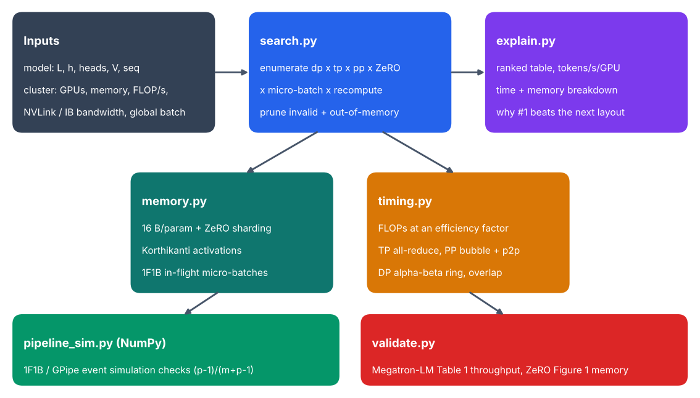
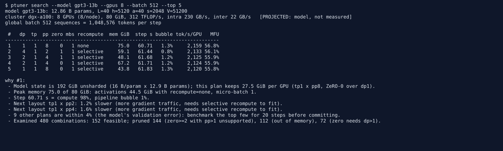

# ptuner: Automatic Parallelism Configuration Tuner for Transformer Training

`ptuner` answers one question that every multi-GPU training job starts with: **how should this model be split
over these GPUs?** It enumerates every combination of data parallelism (DP), tensor parallelism (TP), pipeline
parallelism (PP), ZeRO stage, micro-batch size and activation recomputation, predicts the per-GPU memory and the
step time of each, throws away what does not fit or cannot run, and ranks the rest by tokens per second per GPU,
with a plain-English explanation of why the winner wins.

No GPU is needed: the tuner is a set of analytical models. Every GPU number it prints is a **PROJECTION**, and the
models are checked against published results (Megatron-LM, ZeRO) with the error shown.

## Overview, objectives and key features

Objectives:
- Turn the published memory and time formulas for Megatron-style training into a tool that picks a layout in milliseconds.
- Show *why* a layout wins: memory breakdown, step-time breakdown, the next-best layouts and what they lose to.
- Be honest about accuracy: validate against published numbers, report the error, calibrate with leave-one-out.

Key features:
- **Search space**: DP x TP x PP (all factorizations of the GPU count) x ZeRO 0-3 x micro-batch 1/2/4/8 x recompute none/selective/full.
- **Pruning** with reasons: TP must divide the heads and stay inside a node, PP must divide the layers, the batch must split evenly,
  ZeRO needs DP > 1, ZeRO-2/3 with PP is not supported, and the plan must fit in memory (with headroom).
- **Memory model** per GPU: bf16 weights + gradients + fp32 Adam state (16 B/param) sharded by ZeRO; activations per layer from
  Korthikanti et al. 2022 (with sequence parallelism and recomputation); 1F1B keeps min(p - stage, m) micro-batches in flight;
  logits of the last stage; fixed overhead. The busiest of the first and last stages is reported.
- **Step-time model**: compute at an efficiency factor (smaller GEMMs are slower), memory-bound element-wise work, TP all-reduces
  (4 per layer per micro-batch, 6 with full recompute), PP send/receive and bubble (p - 1)/(m + p - 1), DP gradient all-reduce
  with an alpha-beta ring cost, overlap with the backward pass, optimizer step.
- **Validation**: 10 configurations of Megatron-LM Table 1 (Narayanan et al., SC'21): mean absolute error 3.5%, leave-one-out 3.7%.
  ZeRO paper Figure 1 model-state memory reproduced exactly.
- **Pipeline simulator** (NumPy, discrete events) for GPipe and 1F1B that verifies the bubble formula and the in-flight micro-batch count.
- JSON output, a cluster description file, Docker image and a Kubernetes pre-flight Job.

## Architecture



`cli.py` parses the model and cluster; `search.py` enumerates and prunes plans; for each plan `memory.py` gives the peak
bytes per GPU and `timing.py` the step time; `explain.py` turns the ranked list into a table and reasons. `validate.py`
runs the same models on published configurations; `pipeline_sim.py` checks the bubble formula by simulation.

## Tech stack

- Python 3.10+ and NumPy (models, simulator). No GPU, no deep-learning framework.
- pytest (tests), matplotlib (docs figures only).
- Docker, Kubernetes (Job + ConfigMap), GitHub Actions.

## Project structure

```
3.6-parallelism-tuner/
|-- src/ptuner/
|   |-- config.py        # Model, Cluster, Plan, Knobs + presets
|   |-- memory.py        # per-GPU memory: model state, ZeRO, Korthikanti activations, in-flight micro-batches
|   |-- timing.py        # step time: compute, TP/PP/DP communication (alpha-beta), bubble, MFU
|   |-- search.py        # enumerate DP x TP x PP x ZeRO x mbs x recompute, prune, rank
|   |-- explain.py       # ranked table and plain-English reasons
|   |-- validate.py      # Megatron-LM Table 1 and ZeRO Figure 1 checks, leave-one-out calibration
|   |-- pipeline_sim.py  # GPipe / 1F1B discrete-event simulator
|   `-- cli.py           # ptuner search | validate | bubble | list
|-- tests/               # 33 tests
|-- scripts/bench.py  scripts/make_figures.py
|-- deploy/k8s/tuner-job.yaml
|-- docs/architecture.png  docs/demo.png  docs/validation.png
|-- Dockerfile  .dockerignore  Makefile  pyproject.toml  LICENSE
```

## Installation

Local:

```bash
cd 3.6-parallelism-tuner
pip install -e ".[dev]"
make test demo validate
ptuner search --model gpt3-13b --gpus 8 --batch 512
```

Docker:

```bash
docker build -t ptuner .
docker run --rm ptuner validate
docker run --rm ptuner search --model gpt3-175b --gpus 128 --batch 1536 --json --top 3
```

Kubernetes (pre-flight Job, no GPU requested): `kubectl apply -f deploy/k8s/tuner-job.yaml`.

## Demo



Real output of `ptuner search --model gpt3-13b --gpus 8 --batch 512` (numbers are PROJECTED, not measured):

```
 #   dp  tp  pp zero mbs recompute  mem GiB  step s bubble tok/s/GPU   MFU
 1    1   1   8    0   1 none          75.0   60.71   1.3%     2,159 56.8%
 2    4   1   2    1   1 selective     59.1   61.44   0.8%     2,133 56.1%
 3    2   1   4    1   1 selective     48.1   61.68   1.2%     2,125 55.9%
why #1:
 - Model state is 192 GiB unsharded (16 B/param x 12.9 B params); this plan keeps 27.5 GiB per GPU (tp1 x pp8, ZeRO-0 over dp1).
 - Peak memory 75.0 of 80 GiB: activations 44.5 GiB with recompute=none, micro-batch 1.
 - 9 other plans are within 4% (the model's validation error): benchmark the top few for 20 steps before committing.
```

## Selected code samples

Pipeline bubble inside the step-time model (`timing.py`):

```python
per_mb = t_mb + tp_mb + pp_mb
pipe = (mb + plan.pp - 1) * per_mb          # 1F1B: m micro-batches + (p - 1) fill/drain slots
bubble = (plan.pp - 1) * per_mb
```

Ring all-reduce, alpha-beta model:

```python
def ring_allreduce_s(nbytes, n, gbs, alpha_us):
    if n <= 1:
        return 0.0
    return 2 * (n - 1) / n * nbytes / (gbs * 1e9) + 2 * (n - 1) * alpha_us * 1e-6
```

Activation bytes per layer and micro-batch (Korthikanti et al. 2022, Table 2):

```python
if recompute == "selective":
    return sbh * 34 / tp if seq_parallel else sbh * (10 + 24 / tp)
```

## Benchmark summary

Measured on a 2-core CPU (wall time of the tuner itself, `make bench`):

| Case | Plans examined | Feasible | Search time |
|---|---:|---:|---:|
| gpt3-13b on 8 GPUs | 480 | 158 | 2.2 ms |
| gpt3-175b on 64 GPUs | 1,344 | 57 | 12.7 ms |
| gpt3-175b on 512 GPUs | 2,640 | 150 | 30.3 ms |
| gpt-1t on 3,072 GPUs | 9,504 | 87 | 31.0 ms |

Pipeline simulator: 1F1B with p = 16, m = 256 (8,192 operations) in 53.7 ms; simulated bubble equals (p - 1)/(m + p - 1) to 1e-12.

Accuracy against published results (`ptuner validate --loo`):

| Check | Source | Result |
|---|---|---|
| TFLOP/s per GPU, 10 GPT models 1.7B-1T on 32-3,072 A100 | Narayanan et al. 2021, Table 1 | mean abs. error 3.5% (max 8.2%) |
| Same, leave-one-out calibration | - | held-out mean abs. error 3.7% |
| Model-state GB per GPU, 7.5B, 64 GPUs, ZeRO 0-3 | Rajbhandari et al. 2020, Figure 1 | 120.0 / 31.4 / 16.6 / 1.9 GB, exact |

All throughput, memory and MFU numbers for GPUs are **PROJECTED** by the model (datasheet peaks, assumed effective
bandwidths, efficiency 0.65). To measure: run Megatron-LM `pretrain_gpt.py` with the plan's `--tensor-model-parallel-size`,
`--pipeline-model-parallel-size`, `--micro-batch-size` and `--recompute-granularity` for 20 steps and compare the logged
TFLOP/s and `torch.cuda.max_memory_allocated()`.

## Test summary

33 tests, about 2 s (`make test`):

| File | Tests | Covers |
|---|---:|---|
| test_memory.py | 8 | ZeRO Figure 1 exact, published parameter counts, Korthikanti formulas, 1F1B in-flight count, 175B needs a pipeline, Megatron configs fit |
| test_pipeline_sim.py | 6 | simulated bubble = formula (GPipe and 1F1B), in-flight bounds, op order, jitter and send delay |
| test_search_cli.py | 10 | divisors, every ranked plan valid and fits, pruning reasons, slow links avoid TP, no-fit exit code, CLI text/JSON, cluster file |
| test_timing.py | 9 | Megatron FLOPs equation 3, 6N rule, alpha-beta ring, intra vs inter link, throughput identity, ZeRO-3 traffic, Table 1 error bounds, leave-one-out |

```
tests/test_timing.py::test_megatron_table1_error_bounds PASSED           [ 96%]
tests/test_timing.py::test_leave_one_out_generalises PASSED              [100%]
============================== 33 passed in 1.76s ==============================
```

## Learning outcomes

- Compute the memory of any DP x TP x PP x ZeRO plan by hand: model state, activations, in-flight micro-batches.
- Explain where step time goes: compute efficiency, TP all-reduces, the pipeline bubble, DP gradient sync and overlap.
- Use the alpha-beta model to decide whether a collective belongs on NVLink or on the network.
- Validate a performance model against published numbers and report its error honestly (including leave-one-out).
- Verify a closed-form formula with a simulator.

## License

MIT License. Copyright (c) 2026 Tahsin Shahrear. See [LICENSE](LICENSE).
