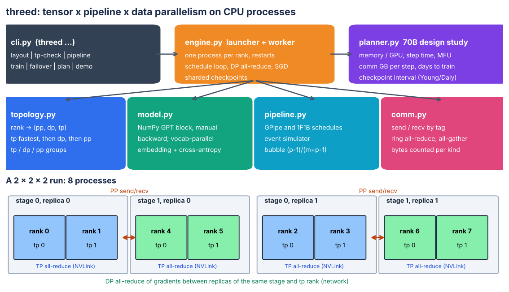
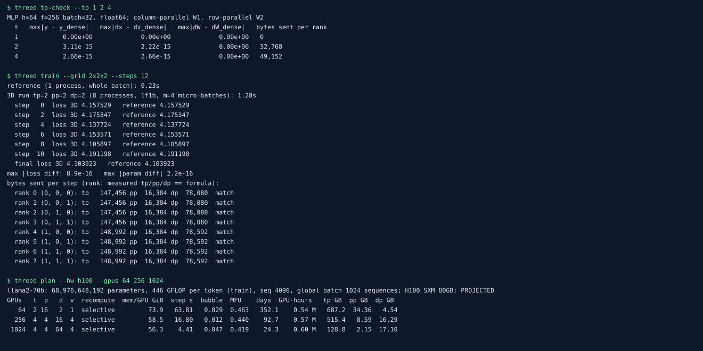

# threed: 3D Parallelism (Tensor x Pipeline x Data) from Scratch, plus a 70B Training Planner

`threed` trains a small GPT-style transformer with **tensor, pipeline and data parallelism at the same time**,
using one operating-system process per "GPU" and plain NumPy, and proves that the result is the same model a
single process would have produced (to 1e-13). Next to it sits a **design-study planner** for a
Llama-2-70B-sized model: memory per GPU, communication per step, step time, MFU, days to train and
checkpoint policy for every (tensor, pipeline, data) split of 64 to 2,048 GPUs.

No GPU is needed. Everything that runs here is measured on CPU; every GPU number is a **projection** from an
analytical model with stated assumptions, and is labelled as such.

## Overview, objectives and key features

Objectives:
- Show exactly how Megatron-style 3D parallelism splits a transformer, where every byte of communication goes, and why.
- Make the pipeline bubble, activation memory and communication volume measurable, and check them against their formulas.
- Turn the same formulas into a planner that answers "how should we lay out 70B parameters on N GPUs?" with reasons.

Key features:
- **Process grid** `rank -> (pp, dp, tp)` with tensor rank fastest, so every tensor-parallel group stays inside one 8-GPU node.
- **Tensor parallelism** (Megatron): column-parallel QKV and MLP-in, row-parallel attention-out and MLP-out,
  vocab-parallel embedding and a vocab-parallel cross-entropy that never gathers the logits.
- **Pipeline parallelism** with GPipe and 1F1B schedules, an event simulator, ASCII Gantt charts and a measured bubble.
- **Data parallelism** with a ring all-reduce of the gradients (reduce-scatter + all-gather).
- **Exactness**: 3D training equals single-process training; measured bytes per rank equal the closed-form formulas.
- **Failures**: a killed rank is detected (not hung), all ranks restart from the last sharded checkpoint, and the
  final model is identical to an uninterrupted run.
- **70B planner** (`threed plan`): exact Llama-2-70B parameter count, memory model (ZeRO-1, selective/full
  recomputation, interleaving), step-time model, best plan per GPU count, alternatives and why they lose,
  Young/Daly checkpoint interval from a published failure rate.

## Architecture



| Module | Role |
|---|---|
| `topology.py` | Grid, rank <-> (pp, dp, tp), tp/dp/pp groups, which groups stay inside a node |
| `comm.py` | Per-rank inbox, send/recv by tag, ring all-reduce and all-gather, bytes counted per kind |
| `model.py` | NumPy GPT block with hand-written backward; shard/unshard for t tensor-parallel ranks |
| `tensor_parallel.py` | Column/row-parallel MLP check against the dense MLP |
| `pipeline.py` | GPipe and 1F1B schedules, simulator, bubble formula, Gantt renderer |
| `engine.py` | Launcher (one process per rank), training worker, checkpoints, restarts, expected traffic |
| `planner.py` | 70B design study: memory, step time, MFU, days, checkpoint policy (projected) |
| `cli.py` | `threed layout | tp-check | pipeline | train | failover | plan | demo` |

## Tech stack

- Python 3.10+ and NumPy (float64 so exactness checks are meaningful)
- `multiprocessing` (fork) queues as the interconnect; ring collectives written by hand
- pytest; matplotlib only for the two images in `docs/`
- Docker (python:3.12-slim, non-root), Kubernetes Jobs, GitHub Actions

## Project structure

```
3.7-3d-parallelism-70b/
|-- src/threed/
|   |-- topology.py         # process grid and groups
|   |-- comm.py             # send/recv, ring all-reduce, all-gather, byte counters
|   |-- model.py            # tensor-parallel GPT in NumPy with manual backward
|   |-- tensor_parallel.py  # column/row-parallel MLP
|   |-- pipeline.py         # GPipe, 1F1B, simulator, bubble formula
|   |-- engine.py           # launcher, 3D worker, checkpoints, restarts
|   |-- planner.py          # 70B design study (projected)
|   `-- cli.py  __main__.py  __init__.py
|-- tests/                  # 61 tests
|-- scripts/make_docs.py    # renders docs/architecture.png and docs/demo.png
|-- deploy/k8s/threed-jobs.yaml
|-- docs/architecture.png  docs/demo.png
|-- Dockerfile  .dockerignore  Makefile  pyproject.toml  LICENSE  README.md
```

## Installation

Local:
```bash
cd 3.7-3d-parallelism-70b
pip install -e ".[test]"        # numpy + pytest
make test                       # 61 tests, about 15 s on 2 cores
make demo                       # layout, tp-check, 3D training, failover
make plan                       # the 70B design study (projected)
```

Docker:
```bash
docker build -t threed:latest .
docker run --rm threed:latest train --grid 2x2x2 --steps 12
docker run --rm threed:latest plan --hw h100 --gpus 64 256 1024 --explain 1024
```

Kubernetes (CPU-only Jobs): `kubectl apply -f deploy/k8s/threed-jobs.yaml`

## Demo



Real output of `threed tp-check`, `threed train --grid 2x2x2` and `threed plan` (regenerate with `make docs`).

## Selected code samples

Rank to coordinates, tensor rank fastest (`topology.py`):
```python
tp = rank % self.tp
dp = (rank // self.tp) % self.dp
pp = rank // (self.tp * self.dp)
```

One all-reduce per MLP in the forward pass (`tensor_parallel.py`):
```python
def row_fwd(x_r, w_r, b, tp):
    return tp.all_reduce(x_r @ w_r) + b                  # g operator
```

1F1B: warm up with p - s - 1 forwards, then alternate (`pipeline.py`):
```python
warm = min(p - s - 1, m)
ops = [("F", i) for i in range(warm)]
while f < m:
    ops.append(("F", f)); f += 1
    ops.append(("B", b)); b += 1
```

## Benchmark summary

Measured on a 2-core CPU machine (Python 3.13, NumPy):

| What | Result |
|---|---|
| 3D training tp=2 pp=2 dp=2 (8 processes, 1F1B, 30 steps) vs one process | max loss diff 1.0e-13, max parameter diff 1.6e-13 |
| Bytes sent per rank per step (tp / pp / dp) | equal to the closed-form formula on all 8 ranks |
| Tensor-parallel MLP, t = 2, 4, 8 vs dense | max error 3e-15 (float64 rounding) |
| Pipeline p=4, m=8: simulated bubble | 0.273 = (p-1)/(m+p-1) for GPipe and 1F1B |
| Pipeline p=4, m=8, 4 real processes | measured bubble 0.309 (GPipe), 0.286 (1F1B) |
| Peak activations held by stage 0, m=8 | GPipe 8, 1F1B 4 |
| Kill rank 5 at step 3, restart from checkpoint | 1 restart, final parameters differ by 2.1e-17 |

**PROJECTED (not measured)** by `threed plan` for a Llama-2-70B-sized model (68,976,648,192 parameters),
seq 4096, global batch 1024 sequences, 2T tokens. Assumptions: datasheet BF16 peak (H100 SXM 989 TFLOP/s,
A100 312), 50% kernel efficiency, 75% of link bandwidth, 80% of data-parallel traffic overlapped.

| GPUs (H100) | best t x p x d (v) | memory/GPU | step | MFU | days |
|---|---|---|---|---|---|
| 64 | 2 x 16 x 2 (1) | 73.9 GiB | 63.8 s | 0.46 | 352 |
| 256 | 4 x 4 x 16 (4) | 58.5 GiB | 16.8 s | 0.44 | 93 |
| 1024 | 4 x 4 x 64 (4) | 56.3 GiB | 4.41 s | 0.42 | 24 |

A100 x 2048 projects 1.87 M GPU-hours for 2T tokens; Llama 2 70B reported 1.72 M (the efficiency factor is
calibrated to this). Measure real numbers with Megatron-LM or torchtitan on your cluster
(`torchrun --nnodes N --nproc-per-node 8 ...` with `--tensor-model-parallel-size 4 --pipeline-model-parallel-size 4`)
and compare step time and `torch.cuda.max_memory_allocated()`.

## Test summary

61 tests, all passing (`make test`, about 13 s on 2 CPU cores):

| File | Tests | What they cover |
|---|---|---|
| test_topology.py | 5 (+params) | coordinates round-trip, groups partition the world, tp inside a node |
| test_comm.py | 5 (+params) | ring all-reduce equals NumPy, max, all-gather order, out-of-order tags, timeouts |
| test_model.py | 3 | backward equals finite differences, shard/unshard round-trip, shard shapes |
| test_tensor_parallel.py | 3 (+params) | parallel MLP and transformer equal dense; exactly one all-reduce each way |
| test_pipeline.py | 4 (+params) | schedules valid, bubble equals formula, 1F1B memory, measured bubble |
| test_engine.py | 5 (+params) | 3D training equals one process (4 grids), bytes equal formula, crash detected, restart exact |
| test_planner.py | 7 (+params) | exact 70B count, pure DP does not fit, best plans fit, Llama 2 GPU-hours calibration, checkpoint policy |

```
.............................................................            [100%]
61 passed in 12.54s
```

## Learning outcomes

- How a 3D process grid is laid out and why tensor parallelism must stay inside an NVLink node.
- Column- and row-parallel layers, the f/g conjugate operators, vocab-parallel cross-entropy.
- Pipeline schedules: why the bubble is (p-1)/(m+p-1) and why 1F1B keeps p activations instead of m.
- Ring all-reduce costs 2(n-1)/n of the data per rank, and how to predict every byte a rank sends.
- Memory per GPU for a 70B model: weights, gradients, sharded optimizer, activations, and what does not fit.
- Choosing t, p, d for a GPU budget; MFU and time-to-train; checkpoint interval from failure rates.
- Detecting failed ranks without hanging, and exact restart from sharded checkpoints.

## License

MIT License. Copyright (c) 2026 Tahsin Shahrear. See [LICENSE](LICENSE).
